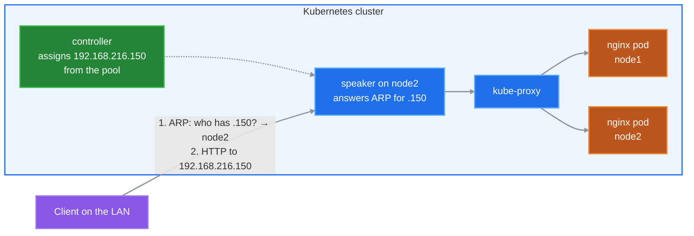
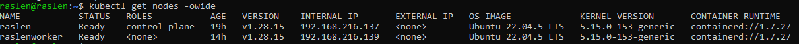
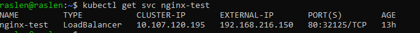
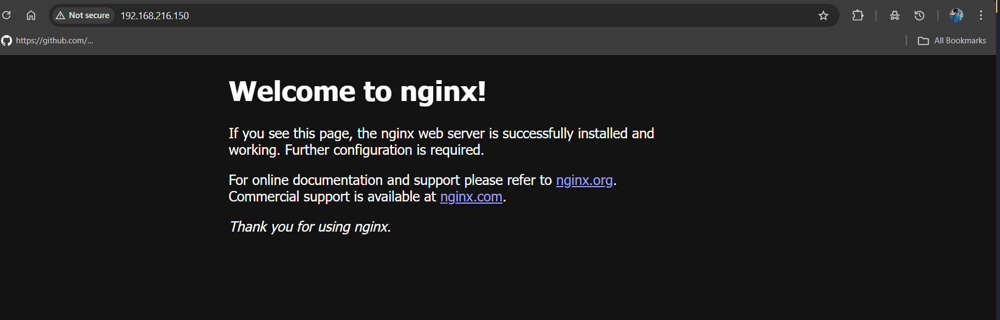

# MetalLB Lab


-238636?style=flat-square)

`LoadBalancer` Services on a bare-metal or VM Kubernetes cluster, with MetalLB in Layer 2 mode.
Three scripts install it, prove it works, and remove it.

## Why MetalLB

On a cloud provider, a Service of type `LoadBalancer` gets an external IP from the cloud. On bare metal or VMs nothing provides one, so `EXTERNAL-IP` stays `<pending>` forever. MetalLB fills that gap: it gives each `LoadBalancer` Service an IP from a range of your LAN, and makes that IP reachable.

## How Layer 2 mode works



1. The **controller** gives the Service a free IP from the pool.
2. One **speaker** (the one on node2 here) takes ownership of that IP and answers ARP requests for it with its node's MAC address.
3. Clients send their traffic to that node; **kube-proxy** then spreads it over the Service's pods, on any node.

If node2 goes down, a speaker on another node takes the IP over and announces it.

## Quick start

You need a cluster with `kubectl` access, and a range of **free** IPs in the **same subnet** as the nodes. Check the node IPs:

```bash
kubectl get nodes -o wide
```



Set your range in [manifests/ipaddresspool.yaml](manifests/ipaddresspool.yaml) (this lab uses `192.168.216.150-192.168.216.160`), then, from the repository root:

```bash
./scripts/install.sh   # install MetalLB v0.15.2, then the IP pool and L2 advertisement
./scripts/test.sh      # expose nginx as a LoadBalancer and check it answers on its IP
```

Expected result of the test:

```text
PASS  nginx answers on http://192.168.216.150
```

The Service gets its IP from the pool:



and the IP answers from any machine on the LAN:



To remove the test app, the pool and MetalLB:

```bash
./scripts/cleanup.sh
```

## Repository layout

```text
manifests/ipaddresspool.yaml     the range of IPs MetalLB may assign
manifests/l2advertisement.yaml   announce that range in Layer 2 mode (ARP)
scripts/install.sh               install MetalLB and apply both manifests
scripts/test.sh                  nginx LoadBalancer Service, then an HTTP check on its IP
scripts/cleanup.sh               remove everything
```

## Configuration

| Setting | Where | Default |
|---|---|---|
| IP range | `manifests/ipaddresspool.yaml` | `192.168.216.150-192.168.216.160` |
| MetalLB version | `METALLB_VERSION` variable of the scripts | `v0.15.2` |

For example: `METALLB_VERSION=v0.15.3 ./scripts/install.sh`.

The `memberlist` Secret that encrypts traffic between speakers is created by the MetalLB controller at start-up; there is no need to create it by hand.

## Limitations

- **One node receives all the traffic for an IP.** Layer 2 mode gives failover, not load balancing between nodes; kube-proxy spreads the traffic only after that node.
- **Failover is not instant:** clients keep the old MAC address in their ARP cache until the new owner announces the IP.
- **The IPs must be free and in the nodes' subnet.** Networks that drop ARP replies for unknown IPs, like most cloud VPCs, do not work with Layer 2 mode.

## Related

This setup is stage 2 of [k8s-ingress-tls-lab](https://github.com/raslenraslen/k8s-ingress-tls-lab), where MetalLB gives the NGINX Ingress Controller a stable IP.
